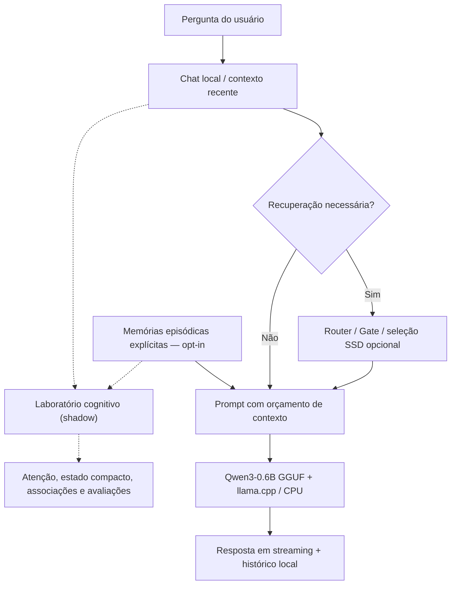

# Brain-SSD

**Uma arquitetura experimental de IA local, inspirada em princípios de memória, atenção e aprendizagem do cérebro humano.**

O objetivo do Brain-SSD é investigar se uma IA pode **manter muito conhecimento persistente no SSD e ativar somente uma pequena parte por tarefa**, usando CPU comum, sem depender de GPU dedicada ou APIs de inferência externas.

> **Status — 10/10/2026:** pesquisa aplicada e protótipo Windows em desenvolvimento. O sistema **não é uma simulação biológica do cérebro**, não transfere memórias humanas e ainda **não demonstrou**, em uma validação completa no hardware-alvo, vantagem de RAM/qualidade sobre a execução convencional do Qwen.

[Começar no Windows](#começar-no-windows) · [Laboratório cognitivo](#laboratório-cognitivo) · [Estado do desenvolvimento](#estado-do-desenvolvimento) · [Próximos objetivos](#próximos-objetivos) · [Documentação](#documentação)

---

## Novo comando da Luna: instalar e usar o Qwen3-4B Q8_0

Na pasta do projeto, feche a Luna antiga e execute no **PowerShell**:

```powershell
.\INSTALAR-QWEN4B-LUNA.bat
```

O comando baixa o GGUF Q8_0 oficial de aproximadamente 4,28 GB **somente
se estiver ausente**, verifica SHA-256, seleciona `Qwen3-4B-Q8_0.gguf`
no `LUNA.ini` e abre o Copiloto. O Qwen3-0.6B original é preservado.
Para reverter sem apagar arquivos:

```powershell
py -3 .\tools\usar_qwen4b_luna.py --restore-06b
```

Veja [download, validações e limitações](docs/LUNA_QWEN_MODEL_AB.md).
Esse é um modelo **de texto**; o modo ligação continua utilizando STT/TTS
locais do navegador, que exigem instalação/permissões separadas.

---
## Experimento Luna: Qwen3-4B Q8_0 vs Qwen3-0.6B Q8_0

A Luna pode testar **um modelo Qwen maior, sem remover o atual**.
O script `tools/test_luna_models.py` lista modelos instalados sem acessar a
Internet; o download oficial de ~4,28 GB só ocorre com `--download`,
seguido de verificação SHA-256. A comparação sequencial `--compare`
executa ambos em CPU e grava respostas e métricas localmente,
sem alegar que 4B será mais rápido ou melhor em todos os casos.
Para ativar o 4B na Luna, escolha `model_file = Qwen3-4B-Q8_0.gguf`
no seu `LUNA.ini` e reinicie. O modelo atual permanece como padrão.

[Guia completo do experimento](docs/LUNA_QWEN_MODEL_AB.md)

---

## Luna HUD — nova interface experimental

A interface web do chat ganhou o visual **Luna**, inspirado em uma central de
comando futurista: núcleo animado, painel operacional, contexto autorizado,
estados reais do chat e ações rápidas. O Qwen local, o Agent Core e as
permissões existentes foram preservados. O HUD não captura a tela, não
executa comandos sozinho e não exige GPU.

Execute o iniciador do Copiloto Windows após atualizar a branch
`feat/ssd-weight-streaming-lab`. Consulte o
[guia da Luna HUD](docs/LUNA_HUD_WINDOWS.md).
Esta etapa ainda depende de revisão visual no PC e não implementa
overlay sempre visível sobre outros aplicativos.

---

## Copiloto local Windows — primeira etapa (experimental)

O atalho **INICIAR-COPILOTO-WINDOWS.bat** oferece permissões explícitas
para ler **uma pasta escolhida**, examinar informações do computador e
capturar a tela sob demanda. O painel **▣** também permite atualização
visual a cada 3 segundos, interrompida ao fechar o painel. Nenhum
arquivo é alterado e capturas não são salvas automaticamente.

A busca opcional pode usar **resultados do Google via Serper**
(`SERPER_API_KEY`), além de Wikipédia, Brave e SearXNG. O provedor
automático preserva Wikipédia quando não há chave. Qualquer pesquisa
externa requer autorização no chat para aquela pergunta.

**Limite:** o Qwen de texto ainda não interpreta as imagens. A integração
de visão computacional real é uma etapa futura.

[Configuração, permissões e limites](docs/COPILOT_WINDOWS.md)

---

## Aprendizado guiado e pesquisa de atualidades (experimental)

O Brain-SSD pode aprender **respostas por exemplos corrigidos explicitamente**
no SQLite (por exemplo, `/ensinar Olá => Olá!`), persistir as correções,
listá-las com `/aprendizados` e excluir com `/desaprender Olá`. Isso
**não altera os pesos do Qwen** e não aprende automaticamente de cada conversa.

Com pesquisa web ativada, perguntas como *Como está a situação do Brasil hoje?*
pedem autorização para consultar notícias datadas da Agência Brasil no modo
`auto`. Resultados são parciais, citados e podem estar indisponíveis.

[Como ensinar e consultar notícias](docs/LEARNING_AND_NEWS.md)

---

## Respostas web rápidas e leitura em voz alta

No chat, ao autorizar **Pesquisar na web**, a opção **Resposta rápida**
apresenta imediatamente os trechos e URLs encontrados, sem esperar a
geração CPU do Qwen. Desmarque-a quando quiser uma resposta sintetizada
pelo modelo. O provedor usa um cache temporário curto e a interface
separa o tempo de pesquisa do tempo de inferência.

Em cada resposta do assistente há **🔊 Ouvir resposta** e **■ Parar áudio**,
usando a Web Speech API do navegador, preferencialmente com voz pt-BR.
O recurso só fala quando solicitado; vozes do navegador podem depender
dos serviços disponíveis no sistema.

[Guia da pesquisa e voz](docs/WEB_SEARCH.md)

---

## Instalação automática e escolha de modelo (Windows)

Abra **INICIAR-BRAIN-SSD.bat** na pasta do projeto. O menu oferece Qwen3
**0.6B**, **1.7B** ou **4B**. O programa instala automaticamente o GGUF
escolhido e o llama.cpp CPU-only apenas se faltarem, verifica SHA-256, roda
o diagnóstico do modelo selecionado e inicia o **chat completo** com memória, aprendizado, base pesquisada e pesquisa web disponível automaticamente (provedor `auto`). A internet só é consultada após autorização para cada pergunta. Nenhum modelo anterior,
histórico ou memória é apagado. Python 3.11+ é necessário; se estiver
ausente, o .bat oferece instalar via winget com confirmação.

[Guia completo do instalador automático](docs/AUTO_SETUP_WINDOWS.md)

---

## Runtime experimental: janelas de pesos SSD → RAM

Na branch experimental `feat/ssd-weight-streaming-lab` iniciamos
um estudo **independente do runtime Qwen** para comparar leitura direta,
LRU, prefetch por transições observadas, `mmap` e carregamento integral
de uma janela limitada.

No Windows, execute `TESTAR-PESOS-SSD-WINDOWS.bat` depois de entrar
na branch experimental. Ele usa um arquivo sintético temporário e gera
resultados em `results/weight_lab/`. O teste **não executa o Qwen**,
não interpreta tensores GGUF e não modifica modelos. Existe uma opção
de leitura somente de uma janela de bytes de arquivo GGUF real.

Consulte [metodologia e comandos](docs/WEIGHT_STREAMING_LAB.md).
Somente comparar a leitura de bytes **não demonstra** vantagem em
tokens/s, RAM total, VRAM ou qualidade de inferência neural.

---

## A ideia

A inspiração é funcional, não anatômica: seres humanos não precisam ativar todas as lembranças simultaneamente para responder a uma pergunta. O Brain-SSD pesquisa a mesma **seletividade computacional** por meio de roteamento, memória episódica, contexto limitado, associação e avaliação de custo.

**Princípio de pesquisa:** capacidade persistente total muito maior que a quantidade de informação/processamento ativada em uma consulta.

O cérebro humano tem mecanismos muito mais complexos do que os implementados aqui. Palavras como *hipocampo*, *córtex*, *consolidação* e *plasticidade* são **analogias de engenharia**, não evidência de equivalência biológica.

### Arquitetura atual



As setas pontilhadas representam **experimentos de diagnóstico**, que **não alteram automaticamente** as respostas nem os pesos do modelo.

## Estado do desenvolvimento

| Área | O que existe | Limite atual |
| --- | --- | --- |
| **Inferência local** | Adaptador para `llama.cpp` CPU-only com Qwen3-0.6B Q8_0 | GGUF e binários precisam estar instalados localmente; teste E2E no PC do usuário pendente |
| **Chat Windows** | Interface, streaming, histórico SQLite e seletor .bat com download verificado | Beta experimental; download e geração com modelos maiores ainda exigem validação no Windows real |
| **SSD seletivo** | Páginas lógicas, índice, roteamento e recuperação de `KnowledgeRecords` | O `brain.dat` completo é opcional para o chat, mas necessário para recuperar a base SSD |
| **Atenção** | Seleção por pistas e orçamento de bytes | Mecanismo cognitivo em **shadow**; melhora de qualidade ainda não comprovada |
| **Memória de trabalho** | Tópicos recentes em estado compacto e histórico limitado | Não equivale à memória de trabalho biológica |
| **Memória episódica** | Notas explícitas, IDs separados, recuperação por pistas e exclusão | Opt-in; não aprende fatos automaticamente de toda conversa |
| **Associação** | Links candidatos entre episódios confirmados | Somente propostas; não implica causalidade |
| **Consolidação** | Fila offline com fontes, aprovação, rejeição e revogação | Não transfere automaticamente notas para o conhecimento do Qwen |
| **Plasticidade / feedback** | Metadados reversíveis com limite, suporte mínimo e decaimento | Não modifica pesos do Qwen ou a verdade factual |
| **Erro de previsão** | Probabilidade, resultado verificado, Brier score e rollback | Aprendizagem limitada a estimativas por tarefa |
| **Percepção e ação** | `GridWorld` isolado com Q-learning e recompensa | Apenas simulação; sem câmera, robótica ou controle do computador |
| **Emulação neural / consciência** | **Não implementadas** | Não há tecnologia comprovada de transferência integral da mente |

## Preparar o chat no Windows quando faltarem modelo ou runtime

O GitHub **não inclui** o GGUF nem binários nativos. Caso o diagnóstico
mostre `FALTA model_gguf_valid_header` ou `FALTA cpu_runtime_found`,
abra `PREPARAR-CHAT-WINDOWS.bat` na raiz do projeto.

O programa **pede confirmação antes de baixar** o GGUF Qwen3-0.6B Q8_0
oficial de [Qwen](https://huggingface.co/Qwen/Qwen3-0.6B-GGUF)
e um pacote CPU x64 oficial de
[llama.cpp](https://github.com/ggml-org/llama.cpp/releases).
Ambos os downloads são validados por SHA-256, não sobrescrevem arquivos
existentes e não alteram histórico ou memória episódica. A distribuição
oficial é instalada separadamente do Core congelado de pesquisa.

Para o terminal CMD, entre primeiro na pasta correta:

```bat
cd /d "%USERPROFILE%\Documents\I.A"
py -3 tools\install_windows_chat.py --all
py -3 tools\doctor_chat.py --profile economia --probe
```

Não execute `tools/doctor_chat.py` a partir da pasta `Documents`: o caminho
relativo só é válido depois de entrar em `I.A`.

**Instalação concluída não comprova inferência.** O diagnóstico e uma resposta
real com Qwen continuam necessários. Veja [CHAT_WINDOWS.md](docs/CHAT_WINDOWS.md).
## Começar no Windows

Requisitos para **conversar realmente com o modelo**: Windows 10/11 x64, Python 3.11+, `llama.cpp` compatível e o arquivo `Qwen3-0.6B-Q8_0.gguf` local.

**O repositório não distribui o GGUF nem todos os executáveis e dados do runtime.** A aprovação da compilação no GitHub Actions **não significa** que o modelo já esteja incluído no launcher.

1. Clone ou atualize este repositório e siga o [guia de preparação do runtime Windows](docs/WINDOWS_NATIVE_RUNTIME.md).
2. Coloque o GGUF esperado na pasta `models/` e configure o `llama.cpp` CPU-only conforme o guia.
3. Abra `DIAGNOSTICAR-CHAT-WINDOWS.bat` para conferir os requisitos (ou execute `python tools/doctor_chat.py --profile economia`).
4. Abra `INICIAR-CHAT-WINDOWS.bat`. O chat será servido em **http://127.0.0.1:8766**.
5. Envie **“Olá!”** e, para conferir a geração real, execute o teste abaixo.

```powershell
python tools/validate_chat_windows.py --profile economia
```

O teste grava um relatório local em `results/chat_validation/latest-local-windows.json`. **Somente executá-lo com o modelo verdadeiro comprova inferência naquela máquina.** Veja instruções detalhadas em [CHAT_WINDOWS.md](docs/CHAT_WINDOWS.md).

### Quando o modelo não inicia no Windows

Se a interface abrir mas mostrar **"Não foi possível iniciar o modelo local"**,
isso indica uma falha na preparação do Core — **não** confirma que o Qwen está
funcionando. Atualize o código e use `DIAGNOSTICAR-CHAT-WINDOWS.bat`.
Os atalhos de chat já fazem o diagnóstico automaticamente. **Não execute
`tools/doctor_chat.py` a partir de `Documents` ou outra pasta sem antes
entrar na raiz do repositório:** o caminho relativo pertence ao Brain-SSD.

A opção mais simples é **abrir `DIAGNOSTICAR-CHAT-WINDOWS.bat` por duplo
clique na pasta do projeto**. Ele próprio localiza a raiz, informa qual
Python foi escolhido e verifica o GGUF e o llama.cpp.

Para usar PowerShell manualmente, substitua o caminho ilustrativo pela pasta
real que contém `tools` e `INICIAR-CHAT-MEMORIA-WINDOWS.bat`:

```powershell
cd "C:\CAMINHO\REAL\DO\I.A"
git pull --ff-only
py -3.11 .\tools\doctor_chat.py --profile economia --probe
```


Se `py -3.11` não estiver instalado, você pode usar o ambiente
`.venvScriptspython.exe` (quando existente) ou executar o BAT, que
escolhe um Python disponível. `py -3` pode selecionar o Python 3.14;
isso **não explica** um erro de arquivo ausente, mas a versão testada no CI
é Python 3.11.

Confira `model_gguf_valid_header`, `model_plausible_size`,
`cpu_runtime_found` e `probe_passed`. Se faltar o modelo, coloque
`Qwen3-0.6B-Q8_0.gguf` na pasta `models/`. Se faltar
`llama-completion.exe`, prepare o runtime CPU-only conforme
[WINDOWS_NATIVE_RUNTIME.md](docs/WINDOWS_NATIVE_RUNTIME.md).
**O GitHub Actions não distribui o GGUF nem garante DLLs nativas no seu PC.**

O terminal e `/api/status` exibem códigos permitidos de erro, sem revelar
pastas pessoais. Caso o problema continue, gere
`python tools/export_diagnostics.py` e anexe o ZIP sanitizado para análise.
As memórias episódicas e o histórico são preservados.

### Perfis de execução

| Perfil | Threads | Contexto configurado | Estratégia |
| --- | ---: | ---: | --- |
| `economia` **(padrão)** | 2 | 2.048 | Processo de inferência descarregado após a consulta |
| `equilibrado` | 4 | 4.096 | Processo descarregado após a consulta |
| `rapido` | 4 | 4.096 | `llama-server` persistente; mantém o modelo carregado por mais tempo |

```powershell
python tools/run_chat.py --profile economia
python tools/run_chat.py --profile equilibrado
python tools/run_chat.py --profile rapido
```

**Nenhum perfil garante uma quantidade específica de RAM.** Um perfil persistente pode diminuir a latência, mas normalmente mantém mais memória ocupada.

### Memória explícita e modo cognitivo experimental

A memória episódica está **desativada por padrão**. Para salvar lembranças intencionalmente e observar métricas cognitivas sem alterar o prompt de inferência:

```powershell
python tools/run_chat.py --profile economia --episodic-memory --cognitive-shadow
```

No Windows também é possível abrir `INICIAR-CHAT-MEMORIA-WINDOWS.bat`. No painel lateral, **Guardar uma lembrança** registra apenas uma nota escolhida pelo usuário; é possível apagá-la. Não salve senhas ou dados confidenciais.

O modo `--cognitive-shadow` calcula diagnósticos de atenção/memória de trabalho, **sem substituir o mecanismo principal de recuperação ou retreinar o modelo**.

## Laboratório cognitivo

Os experimentos abaixo executam **sem modelo GGUF, GPU, internet ou acesso a conversas reais**, em diretórios temporários e com dados fictícios:

```powershell
python tools/run_cognitive_lab.py
python tools/bench_episodic_memory.py
python -m unittest discover -s tests -p "test_cognitive_lab.py" -v
python -m unittest discover -s tests -p "test_consolidation.py" -v
```

O laboratório inclui atenção sob limite de recursos, representação compacta, associação, `replay` de leitura, feedback reversível, erro de previsão e um agente que aprende por recompensa **dentro de um tabuleiro simulado**.

No experimento determinístico atual, o agente inicialmente não alcançava o destino no limite de 100 ações e, após 400 episódios sintéticos de treinamento, alcançou-o em oito ações na avaliação. **Isso não é um benchmark de inteligência geral nem uma melhora validada do Qwen.**

A consolidação de episódios tem um comando específico para **revisão manual**:

```powershell
# Visualizar candidatos já existentes, sem modificar nada:
python tools/review_cognitive_memory.py

# Exemplos de operações explícitas (IDs reais devem ser fornecidos):
python tools/review_cognitive_memory.py --propose EPISODE_ID_1 EPISODE_ID_2
python tools/review_cognitive_memory.py --approve DRAFT_ID --summary "Resumo revisado"
python tools/review_cognitive_memory.py --revoke REVIEWED_ID
```

Os resumos aprovados **não são inseridos automaticamente nos pesos do Qwen nem no corpus SSD**. Consulte [COGNITIVE_LAB.md](docs/COGNITIVE_LAB.md).

## Resultados e limites científicos

O projeto preserva experimentos históricos de armazenamento, `mmap`, cache, roteamento e custo de contexto. Estes resultados devem ser interpretados **somente nos cenários em que foram medidos**.

- O GitHub Actions executa testes do chat usando **backends simulados** e testes reais de término de processos, mas **não inclui o modelo GGUF**.
- Os testes do laboratório cognitivo verificam algoritmos e segurança de execução, **não equivalência ao cérebro humano**.
- Algumas técnicas de redução de contexto diminuíram o custo de processamento, mas mostraram perda de cobertura factual. Por isso, não se tornam padrão sem um **quality gate**.
- Ainda faltam comparações completas com `llama.cpp` puro, incluindo **qualidade em português, memória do processo e da aplicação, RAM do sistema, CPU, I/O físico, TTFT e tokens/s**.
- A validação física canônica em hardware Debian com alvo de **8 GB de RAM** permanece pendente.

Verifique o estado das automações: [Chat Linux](https://github.com/HelioConde/I.A/actions/workflows/chat-smoke.yml) · [Chat/launcher Windows](https://github.com/HelioConde/I.A/actions/workflows/windows-chat.yml) · [Regressão do núcleo](https://github.com/HelioConde/I.A/actions/workflows/core-regression.yml).

## Privacidade e segurança

- Chat HTTP vinculado a `127.0.0.1`, com checagem de origem para operações de escrita; **não exponha a porta por túnel**.
- Histórico persistente e notas episódicas armazenados em **SQLite local**, fora do repositório.
- Memórias de longo prazo são **opt-in**. Feedback e consolidação exigem ações explícitas; há mecanismos de revogação.
- A exclusão do SQLite não garante apagamento físico irrecuperável de blocos SSD/backups.
- Os módulos experimentais de ação operam apenas em ambiente simulado, sem permissão para controlar o computador.
- Respostas de modelos e memórias recuperadas podem conter erros ou informações desatualizadas.

## Logs e análise dos testes

O Brain-SSD registra **eventos estruturados locais**, sem salvar o texto das perguntas,
respostas ou lembranças. No Windows, execute `GERAR-LOGS-WINDOWS.bat` para rodar testes
e gerar um ZIP sanitizado que pode ser anexado à conversa para análise. O GitHub Actions
também publica pacotes de diagnóstico das suítes simuladas.

[Guia de coleta, privacidade e exportação](docs/LOGS_DIAGNOSTICOS.md).

## Qualidade e segurança de memória (experimento)

O chat episódico sinaliza **possíveis diferenças de dia da semana, data,
horário e preço em reais** entre notas confirmadas relacionadas ao mesmo
assunto, sem escolher uma como verdade automaticamente. O aviso é conservador:
podem ser eventos ou produtos diferentes, não necessariamente lembranças
incorretas. Quando o orçamento de contexto não permite apresentar todas as
fontes divergentes e o aviso, o chat omite as notas em disputa e avisa na tela.

Correções adicionais preservam pistas relevantes no final de perguntas longas,
permitem corrigir notas com até 20 revisões e restauração explícita,
normalizam o campo de confirmação vindo do SQLite para uso por associação
e replay, e impedem que feedback de uma memória excluída continue
influenciando o ranking experimental.

Execute `python tools/bench_memory_quality.py`: o conjunto sintético
e lexical contém **24 recuperações positivas, 20 negativas, 5 verificações
de ambiguidade e 1 de exclusão**. Os resultados não medem qualidade do Qwen,
generalização semântica nem memória humana. Veja [COGNITIVE_LAB.md](docs/COGNITIVE_LAB.md).

### Auditoria das lembranças no SSD

Para examinar **somente a integridade** do SQLite episódico, sem mostrar textos,
UUIDs, caminhos ou senhas, execute `python tools/audit_episodic_db.py`.
O relatório informa, de modo agregado, se existem termos desatualizados,
revisões órfãs ou corrupção de estrutura. **A auditoria é somente leitura**;
não modifica dados nem os envia à internet. Consulte [COGNITIVE_LAB.md](docs/COGNITIVE_LAB.md).

### Experimento de sinônimos (desativado por padrão)

A busca episódica pode testar uma **ponte restrita de sinônimos PT-BR**, sem
bibliotecas de embeddings nem conexão externa. É ativada exclusivamente
por `python tools/run_chat.py --episodic-memory --memory-aliases`.
O teste A/B `python tools/bench_semantic_bridge.py` mediu **6/12 acertos**
no baseline lexical e **12/12** com a ponte nos casos sintéticos escolhidos,
sem falsos reconhecimentos nas 12 perguntas negativas de controle. Sinônimos não representam
compreensão semântica geral, e resultados sintéticos não comprovam melhoria
no Qwen. Consulte [COGNITIVE_LAB.md](docs/COGNITIVE_LAB.md).

## Próximos objetivos

1. **P0 — Inferência ponta a ponta no Windows:** confirmar “Olá!”, sessões com vários turnos, encerramento de processos e comportamento offline com GGUF real.
2. **P0 — Qualidade e custo:** comparar Qwen sozinho × Brain-SSD usando o mesmo conjunto de perguntas e medir RAM, CPU, SSD, latência e correção.
3. **P1 — Avaliação cognitiva:** criar conjunto amplo de testes de memória, pistas parciais, contradições, desconhecidos e retenção entre sessões.
4. **P1 — Integração condicionada:** promover módulos de atenção/associação/feedback do modo `shadow` somente se trouxerem ganhos reproduzíveis sem perda de qualidade.
5. **P1 — Consolidação segura:** revisão, proveniência, rollback e medição de esquecimento/interferência antes de qualquer aprendizagem automática.
6. **P2 — Experiência Windows:** empacotamento reproduzível, configuração simples, tratamento de erros, atualizações e instalador completo.
7. **Pesquisa futura:** avaliar percepção–ação em ambientes mais ricos e aprendizagem incremental, sempre com limites de recursos e controles.

**Meta de aceitação:** demonstrar que a arquitetura adiciona utilidade ou eficiência **mensurável** frente ao baseline convencional; não basta adicionar módulos com nomes inspirados no cérebro.

## Documentação

| Tema | Documento |
| --- | --- |
| Instalação e chat Windows | [CHAT_WINDOWS.md](docs/CHAT_WINDOWS.md) |
| Runtime Windows CPU-only | [WINDOWS_NATIVE_RUNTIME.md](docs/WINDOWS_NATIVE_RUNTIME.md) |
| Experimentos cognitivos | [COGNITIVE_LAB.md](docs/COGNITIVE_LAB.md) |
| Neurociência e transferência de memórias | [NEUROCIENCIA_AUDITORIA_2026-10-10.md](docs/NEUROCIENCIA_AUDITORIA_2026-10-10.md) |
| Princípios biológicos e seus limites | [BIOLOGICAL_PRINCIPLES.md](docs/BIOLOGICAL_PRINCIPLES.md) |
| Arquitetura de pesquisa V2 | [NEUROARCHITECTURE_V2.md](docs/NEUROARCHITECTURE_V2.md) |
| Hipóteses testáveis | [HYPOTHESIS_REGISTRY.md](docs/HYPOTHESIS_REGISTRY.md) |
| Auditoria e prioridades | [AUDITORIA_GERAL_2026-10-10.md](docs/AUDITORIA_GERAL_2026-10-10.md) |
| Windows 4E-W e contexto 4F-W | [PHASE_4EW_WINDOWS_VALIDATION.md](docs/PHASE_4EW_WINDOWS_VALIDATION.md) · [PHASE_4FW_CONTEXT_EFFICIENCY.md](docs/PHASE_4FW_CONTEXT_EFFICIENCY.md) |

---

**Brain-SSD é pesquisa de engenharia cognitivamente inspirada.** Não existe hoje, neste projeto, emulação neuronal humana, upload de consciência ou transferência integral de memórias pessoais para um computador.
